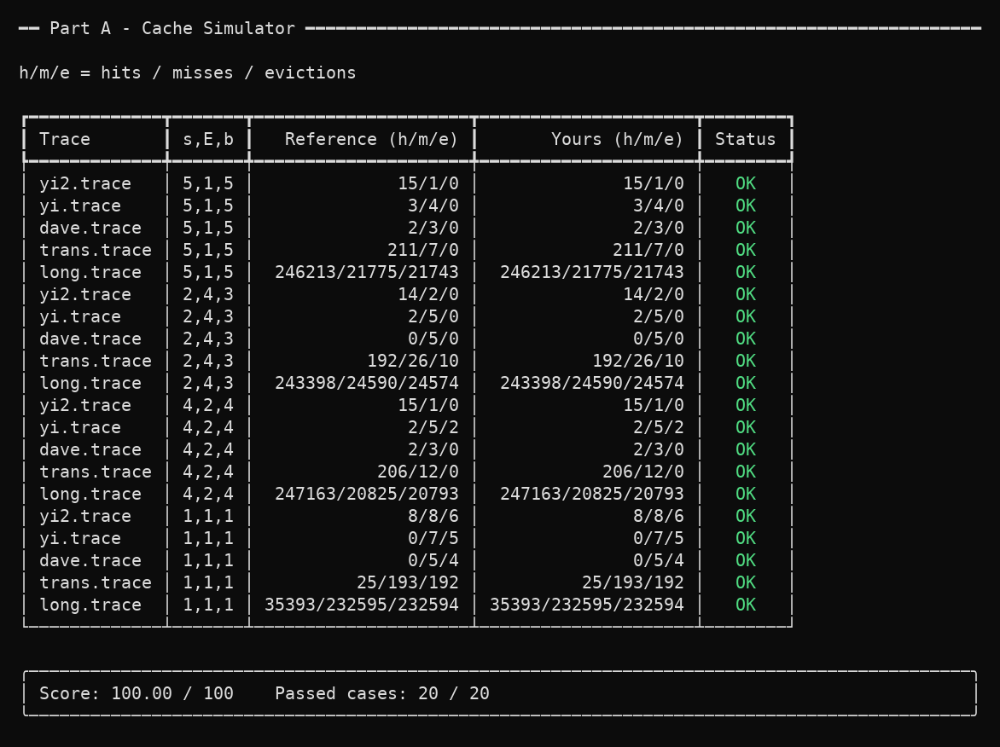
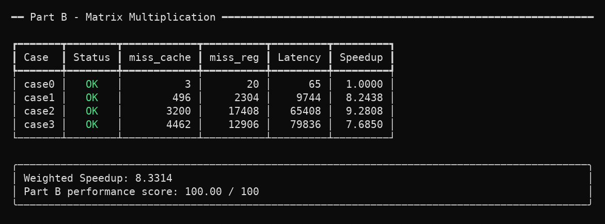

# CacheLab 报告

姓名：王一霖

学号：2025200675

| csim 分数（/100） | case1 speedup | case2 speedup | case3 speedup | weighted speedup | Part B 性能分（/100） |
| ---------------- | ------------- | ------------- | ------------- | ---------------- | ------------------- |
| 100.00 | 8.24 | 9.28 | 7.69 | 8.33 | 100.00 |

<!-- 保留两位小数，四舍五入 -->

本地评测截图：

## Part A: cache 模拟器

### 实现简述

cache 按参数动态分配：`2^s` 个 set，每个 set `E` 行。每行保存 `valid`、`tag` 和 LRU 时间戳。64 位地址的低 `b` 位是块内偏移，中间 `s` 位是 set index，其余是 tag。

一次访问先在对应 set 里找 `valid` 且 tag 相同的行。找到则 hit，并把时间戳更新为全局递增计数。找不到则 miss：set 里还有空行就直接装入；没有空行则 eviction 加一，换掉时间戳最小的那一行。load 和 store 走同一条路径，因为策略是 write-allocate；write-back 只影响脏位，不改变 hits / misses / evictions 这三个计数。trace 里的访问长度只读入，不参与切块，每一行记录按起始地址算一次访问，这样和 `csim-ref` 一致。

### 亮点

## Part B: 矩阵乘法优化

硬件是 `s = 5, E = 1, b = 4`：32 个 set、直接映射、每块 16 字节也就是 4 个 int，总容量 512 字节。A、B、C 从 `0x30000000` 起连续存放。目标是减小 `15 * miss_cache + miss_reg`。

### 亮点

1. 寄存器分块：C 的一块累加值一直放在寄存器里，每个输出元素只 store 一次。baseline 对每个乘加都 load A、load B。
2. 分块大小按 cache 行和冲突选。case1、case2 用 4 行 * 4 列。4 行在直接映射下不会落到同一个 set，4 列正好是一条 cache 行。
3. case3 用 4 行 * 7 列。27 列按 7 切开只剩 6 列边界，A 的重复读取次数从大约 `27 / 4` 降到 `27 / 7`。

#### 我认为的最优秀的实现排序

1. case2
2. case1
3. case3

### case2

baseline：`miss_cache = 36032`，`miss_reg = 66560`，latency `607040`。

优化后：`miss_cache = 3200`，`miss_reg = 17408`，latency `65408`，加速比 9.28。

32 * 32 的一行是 32 个 int，也就是 8 条 cache 行。元素 `(行, 列)` 的 set 是 `(行 * 8 + 列 / 4) mod 32`。同一列块上连续 4 行的 set 分别是 `8r, 8r+8, 8r+16, 8r+24`，互不冲突。第 `r` 行和第 `r+4` 行 set 相同，所以一次取 8 行会在组内互相替换。因此行块取 4，不取 8。

列块取 4，因为一条 cache 行刚好 4 个 int，而且 16 个累加寄存器放得下。k 放在最内层：对固定的 4 行 * 4 列，先把这一列的 4 个 A 读进寄存器，再读 B 的 4 个连续元素，做外积。每个 A 元素被读取 `32 / 4 = 8` 次，每个 B 元素同样 8 次，每个 C 元素只写 1 次，所以

`miss_reg = 1024 * 8 + 1024 * 8 + 1024 = 17408`。

B 的 miss 是 2048，等于「B 的 cache 行数 256，每条行被重新取 8 次」。同一条行里另外 3 个 int 都是 hit，没有额外的冲突 miss。C 的 miss 是 256，等于 `1024 / 4`，全是冷不命中。A 的 miss 是 896，低于按行冷启动估计的 2048，因为沿 k 扫描时，同一条 A 行在接下来的几次访问里还留在 cache 中。

naive 的内层是 `B[k][j]` 的列访问，步长 32 个 int，每次都换一条 cache 行，而且和同一 set 上的 A、C 冲突，所以 66560 次寄存器访问里有 36032 次 cache miss。

### case1

baseline：`miss_cache = 4792`，`miss_reg = 8448`，latency `80328`。

优化后：`miss_cache = 496`，`miss_reg = 2304`，latency `9744`，加速比 8.24。

16 * 16 和 case2 用同一套 4 行 * 4 列内核。一行 16 个 int 是 4 条 cache 行，8 行铺满 32 个 set，所以仍然只取 4 行。每个 A、B 元素被读 `16 / 4 = 4` 次，C 写 1 次：

`miss_reg = 256 * 4 + 256 * 4 + 256 = 2304`。

C 的 64 次 miss、B 的 256 次 miss 都等于「每条相关 cache 行每次被重新装入时 miss 一次」。A 只有 176 次 miss，低于 `64 * 4 = 256`，同样是 k 方向上的空间局部性。

### case3

baseline：`miss_cache = 36869`，`miss_reg = 60507`，latency `613542`。

优化后：`miss_cache = 4462`，`miss_reg = 12906`，latency `79836`，加速比 7.69。

矩阵是 27 * 41、41 * 27、27 * 27。41 除以 4 余 1，每一行的起始位置在 cache 行内错开 1 个 int，4 列的小块经常跨两条 cache 行，所以同样的 4 * 4 内核在这里只有大约 5.72 倍加速（latency 107307）。

27 个累加列按 7 列切开，前 21 列是完整的 4 行 * 7 列，最后 6 列单独一块，最后 3 行再用 3 行 * 7 列和 3 行 * 6 列补上。7 列的累加需要 28 个寄存器。函数参数里的 B、C、buffer 指针在这个 case 里用不到，先 `std::move` 掉，腾出寄存器，峰值正好 36 个。A 的重复次数从约 `27 / 4` 降到约 `27 / 7`，`miss_reg` 从 4 * 4 内核的 16227 降到 12906，miss 从 6072 降到 4462。

## 反馈/收获/感悟/总结

直接映射 cache 下，分块大小首先要避开「隔若干行映射到同一 set」。寄存器数量决定了 C 的块能做多大；块越大，A 或 B 被重复读取的次数越少，但超过 36 个寄存器就会在运行时失败。case3 这种不能整除 cache 行的规模，边界和行对齐比单纯把块加大更影响 miss。

## 参考的重要资料

- 实验说明：CacheLab 2026 README，分块、寄存器复用和 `latency = 15 * miss_cache + miss_reg` 的定义。
- CSAPP Cache Memories，以及 CMU 的 *Waside: Blocking*（https://csapp.cs.cmu.edu/public/waside/waside-blocking.pdf），用来确定按 cache 行分块、避免直接映射冲突。
